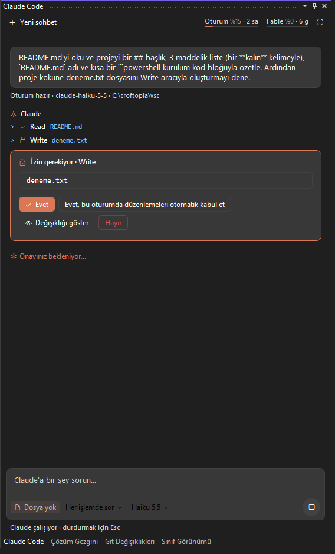
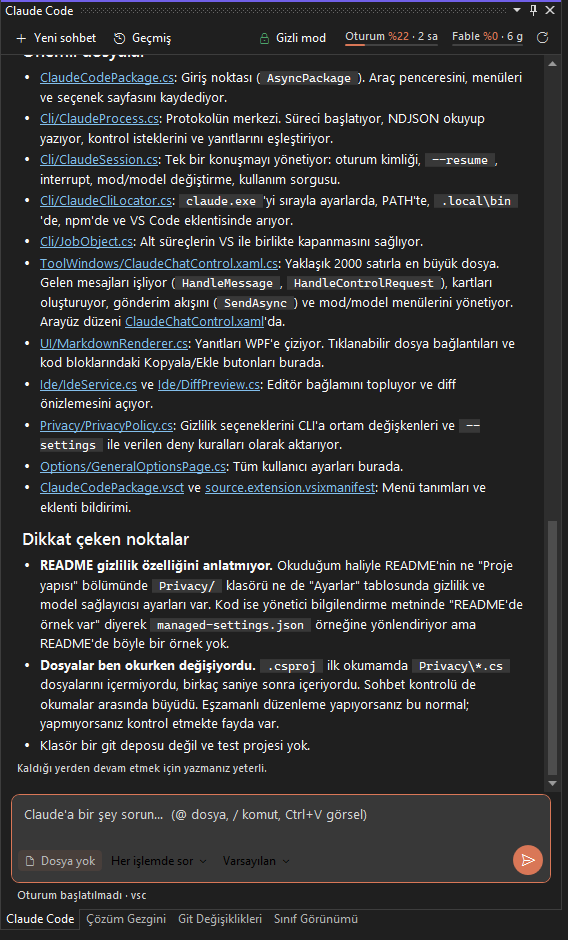
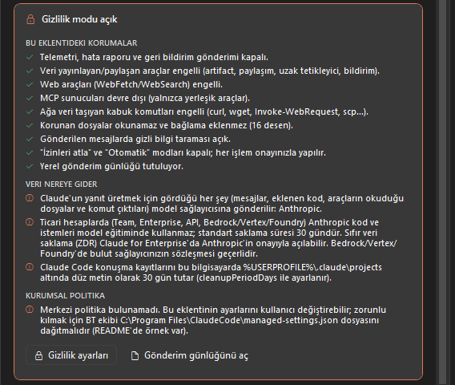
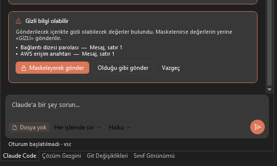
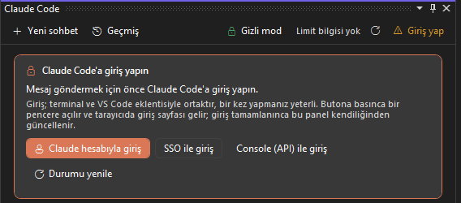

# Codecraftopia Agent for Claude Code

Claude Code'u Visual Studio 2022 içinde bir sohbet paneli olarak kullanın. Claude kodunuzu okur, düzenler ve komut çalıştırır;
yapmak istediği her işlem için panelde onayınız istenir.

> **Resmi olmayan bir eklentidir.** Anthropic ile bağlantılı değildir, Anthropic tarafından desteklenmez. Claude ve Claude Code,
> Anthropic, PBC'nin ticari markalarıdır. Eklenti, bilgisayarınızda kurulu Claude Code CLI'ını kullanır.

## Özellikler

- **Sohbet paneli:** Yanıtlar canlı akar. Başlık, liste, tablo ve kod blokları biçimlendirilir; dosya bağlantıları tıklanınca
  ilgili satırda açılır. Kod bloklarında *Kopyala* ve *Ekle* (imlecin olduğu yere) butonları bulunur.
- **İzin kartları:** Dosya düzenleme ve komut çalıştırma öncesinde *Evet / Bir daha sorma / Hayır* seçenekleri sunulur.
  Önerilen değişiklik, onaylamadan önce Visual Studio'nun diff görünümünde incelenebilir.
- **Plan modu ve sorular:** Claude'un hazırladığı plan ve seçenekli soruları kart olarak gösterilir.
- **Geçmiş:** Klasördeki önceki sohbetler aranabilir bir listede görünür; tıklayınca kaldığınız yerden devam edersiniz.
- **`@` ile dosya, `/` ile komut:** Proje dosyaları ve Claude Code komutları açılır listeden seçilir.
- **Görseller:** Ekran görüntüsünü Ctrl+V ile yapıştırın ya da sürükleyip bırakın.
- **Kullanım ve bağlam:** 5 saatlik oturum limiti ile haftalık limitler ve konuşmanın bağlam doluluğu panelde görünür.
- **Editör entegrasyonu:** Sağ tık menüsünde *Seçimi Claude'a Ekle* ve *Claude ile Açıkla*; aktif dosya ve seçim bağlam olarak eklenir.
- **Hesap:** Hangi hesapla bağlı olduğunuz görünür; giriş yapılmamışsa panelden giriş başlatılır.

## Kurumsal gizlilik modu

Şirket kodunun gereksiz yere dışarı çıkmaması için varsayılan olarak açıktır:

- Telemetri, hata raporu ve geri bildirim gönderimi kapalıdır; içerik yayınlayan araçlar, web araçları ve MCP sunucuları devre dışıdır.
- `curl`, `Invoke-WebRequest`, `scp` gibi ağ komutları engellenir; `.env`, `*.pfx`, `secrets/**` gibi korunan dosyalar okunamaz.
- Gönderilmeden önce mesajlarda parola, API anahtarı ve bağlantı dizesi taranır ve maskelenmesi önerilir.
- Modele hangi dosyaların gittiği her turda gösterilir ve yalnızca sizin bilgisayarınızda bir günlüğe yazılır.
- Model, Anthropic yerine kendi Amazon Bedrock, Google Vertex AI veya Microsoft Foundry hesabınız üzerinden kullanılabilir.

Not: Claude'un modeli bulutta çalışır; Claude'un yanıt üretmek için gördüğü içerik seçtiğiniz model sağlayıcısına gönderilir.
Gizlilik modu bunun kapsamını daraltır ve görünür kılar, ortadan kaldırmaz.

## Gereksinimler

- Visual Studio 2022 (17.0+) veya Visual Studio 2026 — Community, Professional ya da Enterprise
- [Claude Code](https://code.claude.com) kurulu olmalı ve Claude aboneliği, Anthropic Console, Bedrock, Vertex AI veya Foundry ile
  kullanılabilir durumda olmalıdır. Eklenti `claude.exe`'yi PATH'te, `%USERPROFILE%\.local\bin`'de, npm kurulumunda ve
  VS Code eklentisinin klasöründe kendisi arar.

## Başlarken

1. **Görünüm > Diğer Pencereler > Claude Code** ile paneli açın.
2. Giriş yapılmamışsa paneldeki *Claude hesabıyla giriş* butonunu kullanın.
3. Mesajınızı yazıp **Enter**'a basın.

Ayarlar: **Araçlar > Seçenekler > Claude Code**.

---

## English

**Codecraftopia Agent for Claude Code** brings the Claude Code CLI into Visual Studio 2022 as a chat panel: streaming Markdown
answers, permission cards with diff preview, plan approval, conversation history, `@file` mentions and `/` commands, pasted
images, usage and context indicators, and a corporate privacy mode (no telemetry, blocked publishing/web tools and network
commands, protected files, secret masking, local audit log, Bedrock/Vertex/Foundry support). The user interface is in Turkish.

Requires an installed and signed-in Claude Code. Unofficial; not affiliated with or endorsed by Anthropic. MIT licensed.
